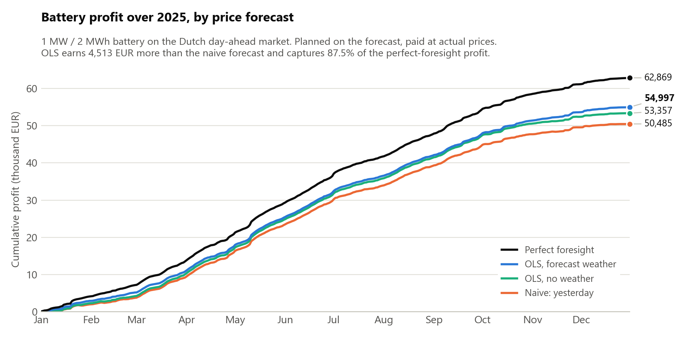
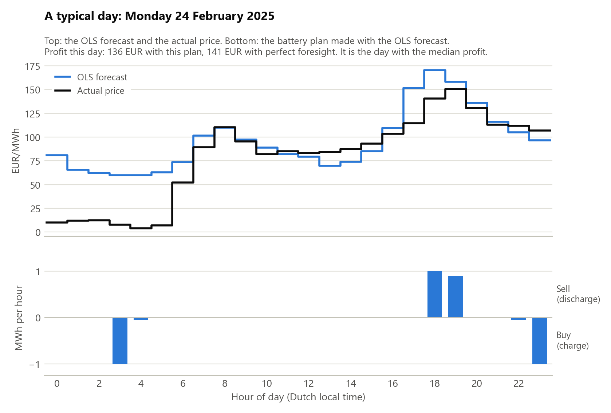

# Forecasting the Dutch day-ahead electricity price

A small, honest forecasting project: does a simple econometric model beat a naive benchmark
when it forecasts tomorrow's hourly Dutch power price on a year it has never seen?

**Short answer: yes.** On the 2025 test set, an OLS regression lowers the mean absolute error
by 23.6% against the best naive benchmark. It only uses weather forecasts that were available before
the auction closed. A Diebold-Mariano test shows the gain is statistically significant
(DM = 6.81, p < 0.001).

**And what is that worth?** A 1 MW / 2 MWh battery that trades on the OLS forecast earns about
4,500 EUR per year more than one that trades on the naive forecast (+9%). See
[From forecast to profit](#from-forecast-to-profit).

A two-page summary is in [outputs/summary.pdf](outputs/summary.pdf).

## Question

The day-ahead auction sets one price for each hour of the next day. Bids close at 12:00 the day
before. Can a simple model, using only information available before that deadline, forecast those
prices better than "the same as yesterday"?

## Data

All data is public and free. Nothing is stored in this repository: the download script fetches it.

| Data | Source | Details |
|------|--------|---------|
| Day-ahead prices | [energy-charts.info](https://www.energy-charts.info) API (Fraunhofer ISE) | Bidding zone NL, EUR/MWh |
| Actual weather | [Open-Meteo](https://open-meteo.com) historical weather API | Used to fit the model (2023–2024) |
| Weather forecasts | Open-Meteo previous-runs API, DWD ICON model | Used to forecast 2025, made 48 hours ahead |

- Weather variables: solar radiation, wind speed at 100 m, temperature.
- Weather is the average of 5 locations: De Bilt, Groningen, Eindhoven, Vlissingen, Den Helder.
- Period: 1 January 2023 to 31 December 2025 (the 2022 energy crisis is left out).
- 26,304 hourly observations. No missing hours, no duplicates.
- Train: 2023–2024 (17,376 hours). Test: 2025 (8,760 hours).

## Method

**Benchmarks** (no fitting needed):

1. Same hour yesterday.
2. Same hour last week.

**Model: OLS regression**, fitted once on 2023–2024 and then used unchanged on 2025:

```
price = hour dummies + weekday dummies + month dummies
        + price yesterday + price last week
        + solar radiation + wind speed + temperature + error
```

**No look-ahead.** The auction for day D closes at 12:00 on day D-1.

- Lagged prices: the prices of day D-1 were published the day before, so they are known in time.
- Weather: in 2025 the model gets the forecast that was made 48 hours before each hour. That
  forecast was always made on day D-2, before the auction closed. A 24-hour-old forecast would not
  be safe: for afternoon hours it was made after 12:00 on D-1.
- The 2025 data was never used for fitting or tuning.

**Why the model is fitted on actual weather.** The forecast archive only starts in February 2024,
so there are no forecasts for 2023. The coefficients are therefore estimated on actual weather
(2023–2024), and the model is tested on real forecasts (2025).

**Significance test.** A Diebold-Mariano test compares each model with "same hour yesterday".
The loss is the absolute error. The loss difference is averaged per delivery day (365 days), because
the 24 hours of one day are forecast at the same moment. Standard errors are Newey-West (7 lags).

**Time handling.** Hour, weekday and month use Dutch local time. Lagged prices are matched by clock
hour, so the 23-hour and 25-hour clock-change days are handled correctly.

## Results

Test set: all 8,760 hours of 2025. Average price in 2025: 86.8 EUR/MWh.

| Model | MAE | RMSE | MAE vs naive | RMSE vs naive | DM stat | p-value |
|-------|-----|------|--------------|---------------|---------|---------|
| Naive: same hour yesterday | 23.94 | 37.23 | – | – | – | – |
| Naive: same hour last week | 30.09 | 45.69 | +25.7% | +22.7% | -4.45 | < 0.001 |
| **OLS, forecast weather** | **18.29** | **26.33** | **-23.6%** | **-29.3%** | **+6.81** | **< 0.001** |
| OLS, actual weather (upper bound) | 17.79 | 25.87 | -25.7% | -30.5% | +7.76 | < 0.001 |
| OLS, no weather | 21.65 | 31.30 | -9.6% | -15.9% | +4.21 | < 0.001 |

MAE and RMSE are in EUR/MWh. Negative % means a lower error than "same hour yesterday".
A positive DM statistic means the model is more accurate than "same hour yesterday".

How to read the three OLS rows:

- **Forecast weather** is the main result. It is what the model would really have achieved.
- **Actual weather** is the upper bound: a perfect weather forecast. Real forecasts cost only
  0.50 EUR/MWh of MAE.
- **No weather** is the lower bound. Most of the gain comes from the weather variables.

The OLS model is more accurate than "same hour yesterday" on 66% of the days in 2025.

Main coefficients (Newey-West standard errors):

| Variable | Coefficient | t-value | Meaning |
|----------|-------------|---------|---------|
| Price yesterday | 0.356 | 8.6 | Prices persist from day to day |
| Price last week | 0.195 | 7.5 | Weekly pattern |
| Solar radiation (W/m²) | -0.086 | -13.1 | More sun, lower price |
| Wind speed (m/s) | -6.07 | -24.5 | More wind, lower price |
| Temperature (°C) | -0.33 | -1.6 | Not significant |

The signs match the merit order: wind and solar have near-zero running cost and push more
expensive plants out of the market.


The sample week was chosen by a rule, not by eye: of all full weeks in 2025 it has the median OLS error.


OLS beats the naive forecast in all 24 hours. The gain is largest in the morning ramp
(hours 6–9, 31–39%). At night (hours 22–4) it is small, only 1–7%.

## From forecast to profit

**How much money is a better price forecast worth?** To find out, a simulated grid battery trades
the Dutch day-ahead market through 2025, once with each forecast.

**Short answer: about 4,500 EUR per MW per year.** That is 9% more profit than with the naive
forecast. The gain is real, but much smaller than the 24% gain in MAE.

### Set-up

- **Battery:** 1 MW power, 2 MWh capacity, 90% round-trip efficiency, at most 1 full cycle per day.
  It starts and ends every day half full. Wear (degradation) costs 10 EUR per MWh sold.
- **Each day:** a linear program picks the 24 hourly charge and discharge amounts that give the
  highest profit at the *forecast* prices. The plan is then paid at the *actual* prices.
- **Four forecasts:** perfect foresight (the actual prices, an upper bound), the main OLS model,
  the naive "same hour yesterday", and OLS without weather.
- **Capture rate** = profit / profit with perfect foresight.

The linear program (solved with HiGHS through `scipy.optimize.linprog`):

```
maximise   sum over hours of  price x discharge - price x charge - 10 x discharge

subject to
  1. energy balance   stored[t] = stored[t-1] + 0.949 x charge[t] - discharge[t] / 0.949
  2. one inverter     charge[t] + discharge[t] <= 1 MW
  3. cycle limit      energy taken out of the battery in a day <= 2 MWh
  4. power            0 <= charge[t], discharge[t] <= 1 MW
  5. capacity         0 <= stored[t] <= 2 MWh
  6. start and end    stored = 1 MWh (50%)
```

0.949 is the square root of 0.90: the loss is split evenly over charging and discharging.
The solver was checked against a small example solved by hand (`battery/check_one_day.py`).

### Results

2025, 365 days, EUR for a 1 MW battery (so also EUR per MW per year).

| Forecast | Profit 2025 | Capture rate | vs naive | Hour ranking score | Days with a loss |
|----------|-------------|--------------|----------|--------------------|------------------|
| Perfect foresight (upper bound) | 62,869 | 100.0% | – | 1.00 | 0 |
| **OLS, forecast weather** | **54,997** | **87.5%** | **+4,513** | **0.87** | **6** |
| Naive: same hour yesterday | 50,485 | 80.3% | – | 0.78 | 22 |
| OLS, no weather | 53,357 | 84.9% | +2,873 | 0.83 | 14 |

- **Value of forecasting = 54,997 − 50,485 = 4,513 EUR per MW per year** (+8.9%).
- It is not noise. The gain is 12.4 EUR per day on average (Newey-West t = 6.8). OLS earns more
  than naive on 59% of days, less on 32%, and the same on 9%.



### Why 24% better MAE gives only 9% more profit

- **A battery trades the shape of the day, not the level.** It only needs to know *which* hours
  are cheap and which are expensive. The "hour ranking score" measures this: the rank correlation
  between forecast and actual prices within a day, averaged over all days.
- **The naive forecast already knows the shape.** Its ranking score is 0.78, against 0.87 for OLS.
  Much of its MAE comes from getting the price *level* of the day wrong, and that costs a battery
  nothing. It captures 80% of the perfect profit with no model at all.
- **Weather adds little money.** OLS without weather already captures 84.9%. Weather adds
  1,640 EUR per year. For MAE, weather gave most of the gain; for profit, about one third.
- **The gain comes from winter.** January, February and October–December give 2,831 of the
  4,513 EUR. In April the gain is 5 EUR: in sunny months the daily pattern repeats, so
  "yesterday" is already a good plan.



The example day was chosen by a rule: of all 24-hour days it has the median profit with the OLS
plan. It shows the point above. At night the forecast is 50–70 EUR/MWh too high, but the plan is
still almost perfect, because the cheap and expensive hours are in the right place. One day is
an illustration, not evidence: over the year the OLS plan captures 87.5%, not 97%.

### Sensitivity

One setting is changed at a time. Profit in EUR per MW per year.

| Battery | Perfect | OLS | Naive | OLS capture | Naive capture | Value of forecasting |
|---------|---------|-----|-------|-------------|---------------|----------------------|
| 1 h (1 MWh) | 32,841 | 28,375 | 25,948 | 86.4% | 79.0% | 2,428 (+9.4%) |
| **2 h (2 MWh), base** | 62,869 | 54,997 | 50,485 | 87.5% | 80.3% | 4,513 (+8.9%) |
| 4 h (4 MWh) | 109,445 | 98,313 | 90,678 | 89.8% | 82.9% | 7,635 (+8.4%) |
| Degradation 0 EUR/MWh | 69,773 | 61,923 | 57,428 | 88.7% | 82.3% | 4,495 (+7.8%) |
| Degradation 20 EUR/MWh | 56,127 | 47,777 | 43,807 | 85.1% | 78.0% | 3,970 (+9.1%) |

- **The conclusion is robust.** OLS beats naive by 8–9% in every case.
- **A longer battery forgives forecast errors.** It spreads its trades over more hours, so
  missing the single best hour hurts less.
- **A higher wear cost makes forecast errors more expensive.** The battery must also decide *if*
  a trade is worth it. At 20 EUR/MWh the OLS plan trades too often and loses money on 24 days.

### Limitations of the battery simulation

- **Day-ahead only.** No intraday or balancing market. Real batteries earn a large part of their
  income there, so this is not a business case.
- **No grid fees or taxes.** Transport tariffs and connection costs are left out.
- **Price taker.** The battery does not move the price. Fine for 1 MW, not for a large fleet.
- **Hourly, not 15-minute.** From 1 October 2025 the market clears per quarter-hour. I use the
  hourly average, which hides part of the price spread.
- **A fixed plan.** The battery commits to volumes. A real trader sends price-limited bids
  ("buy only below X"), which protects against forecast errors.
- **Each day on its own.** The rule "end the day half full" is simple, but sometimes forces a
  purchase in an expensive last hour.
- **One year, one fixed model.** Same caveats as the forecast itself.

## Limitations

- **Trained on actual weather, tested on forecasts.** The two come from different weather models
  (ERA5 reanalysis and DWD ICON). The wind forecast is on average 1.0 m/s higher than the actual
  wind data, which makes the price forecast about 2 EUR/MWh too low on average. I did not correct
  this, because a correction based on 2025 would be look-ahead.
- **48-hour-old forecasts for every hour.** This is stricter than reality. A trader has a fresher
  forecast for the morning hours.
- **One fixed fit.** The coefficients are estimated once. In practice you would re-estimate every day
  on a rolling window.
- **Missing drivers.** No gas price, CO2 price, load forecast, or cross-border flows.
- **Price spikes.** A linear model smooths extremes. It underestimates high evening peaks and does
  not capture negative prices well.
- **One test year.** The test is significant, but 2025 is a single year and one market regime.
- **15-minute prices.** From 1 October 2025 the market clears every 15 minutes. I average the four
  quarter-hours to get an hourly price.

## What I would do next

1. Train the model on forecasts too, once the forecast archive is long enough, or correct the level
   of the forecasts using data from before the test year.
2. Use the freshest forecast that is available at 12:00 on D-1 for each hour.
3. Re-estimate the model every day on a rolling window.
4. Add gas and CO2 prices and the ENTSO-E day-ahead load and wind/solar forecasts.
5. Compare with one non-linear model (for example LightGBM) to see if it handles spikes better.

## How to run

```
pip install -r requirements.txt
python main.py
```

`main.py` runs every step in order. Data files that already exist are not downloaded again;
add `--download` to fetch everything again. Each step can also be run on its own:

| Step | Script | What it does |
|------|--------|--------------|
| 1 | `data/download_data.py` | Downloads prices, weather and weather forecasts to `data/raw/` |
| 1 | `src/check_data.py` | Data-quality report |
| 2 | `src/build_dataset.py` | Merges the data and builds the features |
| 3 | `src/benchmarks.py` | Scores the two naive benchmarks |
| 4 | `src/model_ols.py` | Fits the OLS model and scores it |
| 4 | `src/dm_test.py` | Diebold-Mariano test against the naive benchmark |
| 5 | `src/evaluate.py` | Makes the two result charts |
| 6 | `battery/check_one_day.py` | Checks the one-day battery LP against answers worked out by hand |
| 6 | `battery/backtest.py` | Trades the battery through 2025 with each forecast |
| 6 | `battery/sensitivity.py` | Repeats it for other battery sizes and wear costs |
| 6 | `battery/charts.py` | Makes the two battery charts |
| 7 | `src/make_summary_pdf.py` | Builds the two-page PDF |

The battery model itself is in `battery/battery_lp.py`.

## Folder structure

```
data/download_data.py     download script (raw data is not committed)
src/                      one script per step, plus metrics.py
battery/                  battery model (linear program) and its scripts
outputs/results.csv       forecast results table
outputs/battery/          battery results: profit per forecast, per day, hourly plans
outputs/figures/          charts
outputs/summary.pdf       two-page summary
main.py                   runs everything
requirements.txt
```

## Data credits

- Prices: energy-charts.info, Fraunhofer ISE. Licence CC BY 4.0.
- Weather and weather forecasts: Open-Meteo.com. Licence CC BY 4.0.

This is a student project. Python code was written with AI assistance.
