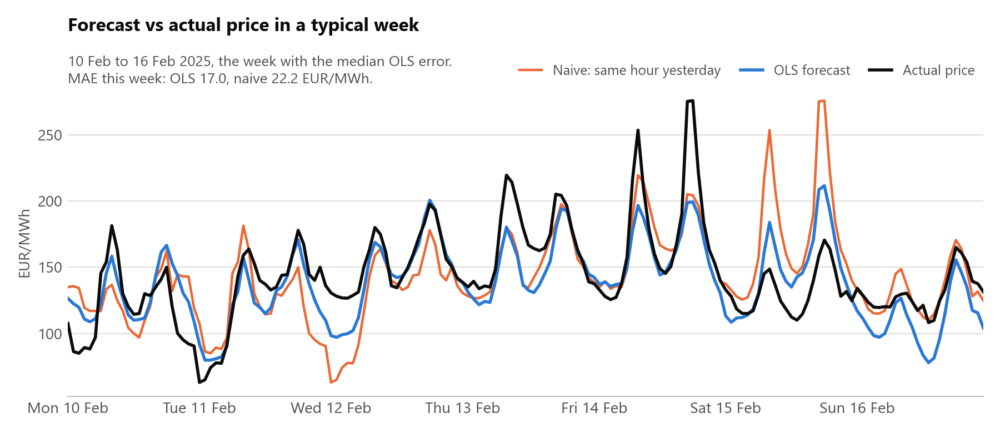
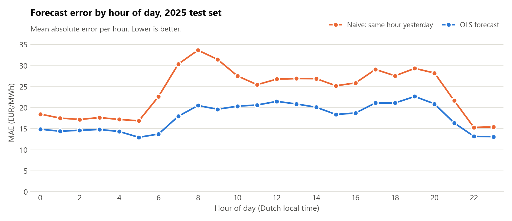

# Forecasting the Dutch day-ahead electricity price

A small, honest forecasting project: does a simple econometric model beat a naive benchmark
when it forecasts tomorrow's hourly Dutch power price on a year it has never seen?

**Short answer: yes.** On the 2025 test set, an OLS regression lowers the mean absolute error
by 25.7% against the best naive benchmark. That number uses actual weather in place of a weather
forecast. Without any weather inputs the gain is 9.6%. A live forecast would land between the two.

A one-page summary is in [outputs/summary.pdf](outputs/summary.pdf).

## Question

The day-ahead auction sets one price for each hour of the next day. Bids close at 12:00 the day
before. Can a simple model, using only information available before that deadline, forecast those
prices better than "the same as yesterday"?

## Data

All data is public and free. Nothing is stored in this repository: the download script fetches it.

| Data | Source | Details |
|------|--------|---------|
| Day-ahead prices | [energy-charts.info](https://www.energy-charts.info) API (Fraunhofer ISE) | Bidding zone NL, EUR/MWh |
| Weather | [Open-Meteo](https://open-meteo.com) historical weather API | Solar radiation, wind speed at 100 m, temperature |

- Period: 1 January 2023 to 31 December 2025 (the 2022 energy crisis is left out).
- Weather is the average of 5 locations: De Bilt, Groningen, Eindhoven, Vlissingen, Den Helder.
- 26,304 hourly observations. No missing hours, no duplicates.
- Train: 2023–2024 (17,376 hours). Test: 2025 (8,760 hours).

## Method

**Benchmarks** (no fitting needed):

1. Same hour yesterday.
2. Same hour last week.

**Model: OLS regression**, fitted once on 2023–2024 and then used unchanged on 2025:

```
price = hour dummies + weekday dummies + month dummies
        + price yesterday + price last week
        + solar radiation + wind speed + temperature + error
```

**No look-ahead.** The auction for day D closes at 12:00 on day D-1. The prices of day D-1 were
already published the day before, so both lagged prices are known in time. The 2025 data was never
used for fitting or tuning.

**Time handling.** Hour, weekday and month use Dutch local time. Lagged prices are matched by clock
hour, so the 23-hour and 25-hour clock-change days are handled correctly.

## Results

Test set: all 8,760 hours of 2025. Average price in 2025: 86.8 EUR/MWh.

| Model | MAE | RMSE | MAE vs best naive | RMSE vs best naive |
|-------|-----|------|-------------------|--------------------|
| Naive: same hour yesterday | 23.94 | 37.23 | – | – |
| Naive: same hour last week | 30.09 | 45.69 | +25.7% | +22.7% |
| **OLS regression** | **17.79** | **25.87** | **-25.7%** | **-30.5%** |
| OLS without weather (check) | 21.65 | 31.30 | -9.6% | -15.9% |

MAE and RMSE are in EUR/MWh. Negative % means a lower error than "same hour yesterday".

Main coefficients (Newey-West standard errors):

| Variable | Coefficient | t-value | Meaning |
|----------|-------------|---------|---------|
| Price yesterday | 0.356 | 8.6 | Prices persist from day to day |
| Price last week | 0.195 | 7.5 | Weekly pattern |
| Solar radiation (W/m²) | -0.086 | -13.1 | More sun, lower price |
| Wind speed (m/s) | -6.07 | -24.5 | More wind, lower price |
| Temperature (°C) | -0.33 | -1.6 | Not significant |

The signs match the merit order: wind and solar have near-zero running cost and push more
expensive plants out of the market.



The sample week was chosen by a rule, not by eye: of all full weeks in 2025 it has the median OLS error.



OLS beats the naive forecast in all 24 hours. The gain is largest in the morning ramp
(hours 6–9, about 40%) and smallest at night, when prices are stable.

## Limitations

- **Weather is actual, not forecast.** The model uses the weather that really happened as a stand-in
  for the forecast. A real forecast has errors, so the 25.7% gain is an upper bound. The model without
  weather (9.6% gain) is the lower bound.
- **One fixed fit.** The coefficients are estimated once. In practice you would re-estimate every day
  on a rolling window.
- **Missing drivers.** No gas price, CO2 price, load forecast, or cross-border flows.
- **Price spikes.** A linear model smooths extremes. It underestimates high evening peaks and does
  not capture negative prices well.
- **Small bias.** In 2025 the OLS forecast is on average 3.4 EUR/MWh too high.
- **One test year.** 2025 is a single sample. I did not test whether the improvement is statistically
  significant.
- **15-minute prices.** From 1 October 2025 the market clears every 15 minutes. I average the four
  quarter-hours to get an hourly price.

## What I would do next

1. Replace actual weather with archived weather forecasts, to get a true out-of-sample number.
2. Re-estimate the model every day on a rolling window.
3. Add gas and CO2 prices and the ENTSO-E day-ahead load and wind/solar forecasts.
4. Test the difference in accuracy with a Diebold-Mariano test.
5. Compare with one non-linear model (for example LightGBM) to see if it handles spikes better.

## How to run

```
pip install -r requirements.txt
python main.py
```

`main.py` runs every step in order. Add `--download` to fetch the data again.
Each step can also be run on its own:

| Step | Script | What it does |
|------|--------|--------------|
| 1 | `data/download_data.py` | Downloads prices and weather to `data/raw/` |
| 1 | `src/check_data.py` | Data-quality report |
| 2 | `src/build_dataset.py` | Merges the data and builds the features |
| 3 | `src/benchmarks.py` | Scores the two naive benchmarks |
| 4 | `src/model_ols.py` | Fits the OLS model and scores it |
| 5 | `src/evaluate.py` | Makes the two result charts |
| 6 | `src/make_summary_pdf.py` | Builds the one-page PDF |

## Folder structure

```
data/download_data.py     download script (raw data is not committed)
src/                      one script per step, plus metrics.py
outputs/results.csv       results table
outputs/figures/          charts
outputs/summary.pdf       one-page summary
main.py                   runs everything
requirements.txt
```

## Data credits

- Prices: energy-charts.info, Fraunhofer ISE. Licence CC BY 4.0.
- Weather: Open-Meteo.com. Licence CC BY 4.0.

This is a student project. Python code was written with AI assistance.
